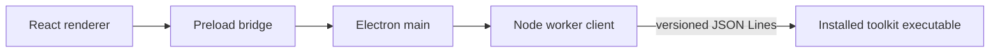

# Desktop client design

## Purpose and ownership

An optional, independently built Electron/React client for an installed AudioLibraryToolkit executable.
This module owns presentation, preferences, dialogs, user confirmation, progress display and desktop packaging.
The [worker protocol v1](https://github.com/guyker/AudioLibraryToolkit/blob/main/docs/api/worker-protocol-v1.md) is the external contract; backend private source/headers and
console wording are not APIs.

## Components and flow

| Component | Location | Responsibility |
|---|---|---|
| Renderer | `apps/desktop/renderer/src/App.tsx` | Operation forms, previews, results, tag choices, settings editors and duplicate review; request/selection and settings-patch rules live in UI-independent `duplicateReview.mjs` and `configurationEditor.mjs` |
| Preload | `apps/desktop/desktop/preload.cjs` | Narrow context-isolated bridge |
| Main process | `apps/desktop/desktop/main.mjs` | Settings, native dialogs, report validation, album-folder opening (allow-list in `album-folders.mjs`) and operation lifecycle |
| Worker client | `packages/worker-client/src/index.ts` | Node child-process launch, request/event validation, completion and cancellation |

The renderer has no Node integration; context isolation and sandboxing remain enabled. The main process controls
process/file access. Only one operation runs at a time. Backend paths come from user settings, never from a required
relative backend source/build location. The client package imports Node APIs, not Electron or React.

## Interaction contracts

Desktop connection preferences persist in Electron's user-data directory as `ui-settings.json`, separately from
backend configuration. A one-time migration preserves the previous `@audio-library/desktop` settings location.
First-run Settings can discover a compatible executable by its worker handshake, load an existing backend config,
or explicitly create one from backend defaults. Blank config path means the backend's default per-user `config.json`.
Discovery checks executable/resource locations, the process working directory and `PATH`; only unpackaged development
builds also check the repository's `out/build` candidate, so packaged discovery has no build-tree dependency.
Reading or validating a missing config creates nothing. Saving edits from a missing snapshot creates a config from
built-in defaults without a backup; explicit Create uses the shipped commented template when available and refuses
to overwrite an existing file. Replacing an existing config retains a `.bak` recovery copy, and revision conflicts
require a reload. Grouped tabs expose all backend-serialized settings. Load, create and save all
rebuild the editors from the snapshot the backend returned, and a save sends only the settings the user changed. The
backend preserves comments and unknown keys, merges nested settings objects member by member, replaces an edited list
as a whole (comments inside that list are lost) and remains responsible for validation and safe file replacement.
Operation forms prefill the configured source path and send the selected input explicitly; catalog JSON inputs remain
separate from audio-library inputs. An unchanged output root is omitted from ordinary operation requests; a changed
output override is sent, and the separate quarantine request sends its required output root.
Duplicate and import forms default their catalog input to `<output-root>/catalog-json/<source-folder-name>`, matching
worker scan output. Duplicate reports default to a unique JSON file in the output root, refreshed after each attempt
so another run does not overwrite the previous report. Manual catalog/report choices (including cleared fields) are
preserved when defaults refresh. Configuration loading updates audio inputs, never catalog inputs with audio paths.
Computing defaults creates no files or directories; backend path validation remains authoritative.

Conversion/repair first request `preview`, display the textual summary, then require execution confirmation.
Execution sends a fresh request; a preview is not a persisted plan or authorization to bypass backend preflight.
Blank MP3 choices preserve the backend's configured tag policy.

Duplicate reports are accepted only as regular files no larger than 20 MiB with supported schema/group/pair fields.
**Find** is report-only: its request carries no `duplicateQuarantinePaths`, so earlier checkbox selections are never
re-sent, and the report stays visible afterwards, also after a quarantine (UI-K-002). The main process remembers the
albums of the latest validated report; **Open folder**/**Open all folders** (`duplicates:open-album-folder`) open only
those existing directories through the shell, so the renderer cannot open arbitrary paths. The app never deletes albums.
Users select individual albums, keep at least one per group (albums already copied to quarantine count as marked), and
confirm quarantine, which names its destination `<output-root>/quarantine`, before paths are sent as a separate
copy-only request; originals, catalog JSON and databases are unchanged.
The UI does not choose a preferred edition or authorize unspecified paths. Backend revalidation is authoritative.

Worker startup/version/parse failures and termination without completion must not look successful. Cancellation
terminates the worker; already installed outputs may remain. Do not imply transactional rollback.

Run status, progress and the stop action live in a compact status strip independent of raw worker output.
No log panel is docked in the workspace. A sticky status strip shows the run message, progress, the latest output
line and **View logs**, plus **Stop worker** while an operation runs. **View logs** opens a same-window overlay (Escape or the backdrop closes it)
with copy, follow-latest and **Open in new window**. The main process keeps a bounded log buffer for the current
operation (the latest 200,000 characters) and streams it to both views. The single auxiliary window closes with the
main window. Logs never open automatically; previews and failures direct users to them through the status message.

## Independent build and delivery

The module has its own npm workspace, lockfile, tests and packaging. Builds require no CMake/compiler/backend source.
The desktop installer contains renderer, Electron main/preload and the Node client, not the toolkit or FFmpeg.
Packaged main loads the client from `process.resourcesPath`; development loads the module-local built client.
Runtime setup requires a compatible separately installed backend and its native prerequisites.

Guides: `docs/guides/`. Features: `docs/features/`. Durable reasons: `docs/knowledge/`; use explicit module-root
knowledge commands from `AGENTS.md`. Do not duplicate toolkit implementation knowledge here.
