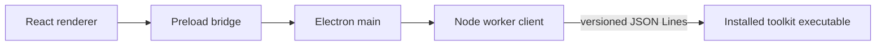

# Desktop client design

## Purpose and ownership

An optional, independently built Electron/React client for an installed AudioLibraryToolkit executable.
This module owns presentation, preferences, dialogs, user confirmation, progress display and desktop packaging.
The [worker protocol](../docs/api/worker-protocol-v1.md) is the external contract; backend private source/headers and
console wording are not APIs.

## Components and flow

| Component | Location | Responsibility |
|---|---|---|
| Renderer | `apps/desktop/renderer/src/App.tsx` | Operation forms, previews, results, tag choices and duplicate selections |
| Preload | `apps/desktop/desktop/preload.cjs` | Narrow context-isolated bridge |
| Main process | `apps/desktop/desktop/main.mjs` | Settings, native dialogs, report validation and operation lifecycle |
| Worker client | `packages/worker-client/src/index.ts` | Node child-process launch, request/event validation, completion and cancellation |

The renderer has no Node integration; context isolation and sandboxing remain enabled. The main process controls
process/file access. Only one operation runs at a time. Backend paths come from user settings, never from a required
relative backend source/build location. The client package imports Node APIs, not Electron or React.

## Interaction contracts

Settings persist in Electron's user-data directory as `ui-settings.json`, separately from backend configuration.
First-run setup sends selected output/library paths through `initializeConfig`. Older preferences missing
`libraryPath` remain readable.

Conversion/repair first request `preview`, display the textual summary, then require execution confirmation.
Execution sends a fresh request; a preview is not a persisted plan or authorization to bypass backend preflight.
Blank MP3 choices preserve the backend's configured tag policy.

Duplicate reports are accepted only as regular files no larger than 20 MiB with supported schema/group/pair fields.
Users select individual albums, keep at least one per group, and confirm quarantine before paths are sent.
The UI does not choose a preferred edition or authorize unspecified paths. Backend revalidation is authoritative.

Worker startup/version/parse failures and termination without completion must not look successful. Cancellation
terminates the worker; already installed outputs may remain. Do not imply transactional rollback.

## Independent build and delivery

The module has its own npm workspace, lockfile, tests and packaging. Builds require no CMake/compiler/backend source.
The desktop installer contains renderer, Electron main/preload and the Node client, not the toolkit or FFmpeg.
Packaged main loads the client from `process.resourcesPath`; development loads the module-local built client.
Runtime setup requires a compatible separately installed backend and its native prerequisites.

Guides: `docs/guides/`. Features: `docs/features/`. Durable reasons: `docs/knowledge/`; use explicit module-root
knowledge commands from `AGENTS.md`. Do not duplicate toolkit implementation knowledge here.
