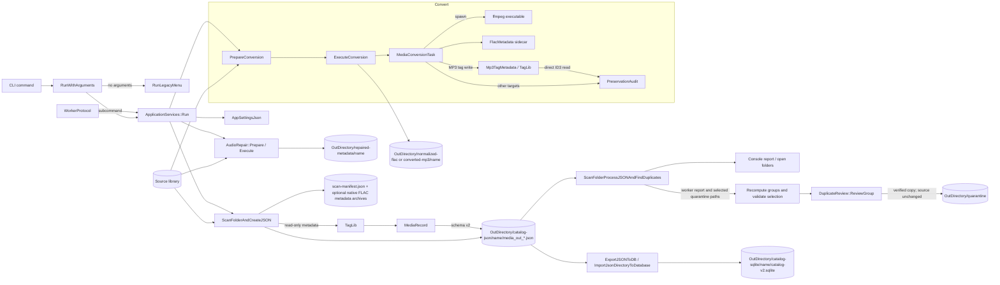

# AudioLibraryToolkit design

What the application is: components, flows, contracts and file formats. Rules for changing it live in
`.github/instructions/`; the reasons behind decisions live in `docs/knowledge/` (K-xxx); user-visible features are
tracked in `docs/features/`. Code is cited as `path#Symbol`.

## Purpose

`AudioLibraryToolkit` is a console utility for a local music library. It:

- converts audio to a separate output tree (16-bit / 44.1 kHz FLAC, or FLAC to MP3) without touching sources;
- repairs recognized FLAC/MP3 metadata defects, without touching audio bytes, into a separate output tree;
- scans libraries into JSON metadata batches;
- finds probable duplicate albums from those batches;
- imports the batches into a per-library SQLite database.

It runs as explicit CLI commands, a versioned headless worker, or, with no arguments, a legacy interactive menu.

## Component map

| Component | Files | Responsibility |
|---|---|---|
| Entry and orchestration | `src/app/AudioLibraryToolkitMain.cpp` | `wmain`/`main` → `RunWithArguments`; `RunLegacyMenu` (menu, previews, `RUN` confirmation, `ManualOperationSummary`); scan, duplicate and DB-import flows |
| CLI parsing | `src/app/CommandLine.cpp`, `include/app/CommandLine.h` | `ParseCommandLine` (CLI11) → `CommandLineOptions` |
| Application services | `src/app/ApplicationServices.cpp`, `include/app/ApplicationServices.h` | `ApplicationServices::Run` owns the shared non-interactive operation dispatch for CLI and worker requests; it delegates to conversion/repair components and narrow scan/catalog adapters |
| Worker protocol | `src/app/WorkerProtocol.cpp`, `include/app/WorkerProtocol.h` | `--worker` JSON Lines request validation and typed `CommandLineOptions` mapping; worker requests call the shared application-service dispatcher, not the CLI parser |
| Run logging | `src/app/RunLogging.cpp`, `include/app/RunLogging.h` | One console/file logger per process request, file-level override, active markers and retention |
| Configuration | `src/app/AppSettings.cpp`, `include/app/AppSettings.h` | `AppSettingsJson` load/save, defaults, process-wide instance; `MediaDirectoryElement` output naming |
| Conversion options | `include/conversion/ConversionOptions.h` | `AudioTarget` (Flac/Mp3), MP3 quality, downmix flag |
| Folder conversion | `src/conversion/FolderConvert.cpp`, `include/conversion/FolderConvert.h` | `FolderConvert::PrepareConversion` (plan) and `FolderConvert::ExecuteConversion` (run, audit report, markers) |
| File conversion | `src/conversion/MediaConversionTask.cpp`, `include/conversion/MediaConversionTask.h` | `MediaConversionTask`: quality gate, FFmpeg child process, output verification, sidecar, audit, installation |
| MP3 tags | `src/metadata/Mp3TagMetadata.cpp`, `include/metadata/Mp3TagMetadata.h` | TagLib maps source FLAC comments into ID3v2.4 and reads MP3 ID3 properties for preservation auditing |
| MP3 tag issues | `src/metadata/Mp3TagIssues.cpp`, `include/metadata/Mp3TagIssues.h` | Detects MP3 tag issues, lists resolution choices (recommended first) and applies the selected resolutions to source comments |
| Metadata repair | `src/repair/AudioRepair.cpp`, `include/repair/AudioRepair.h`, `src/repair/RepairRules.cpp`, `include/repair/RepairRules.h` | `RepairRules::Analyze` detects FLAC/MP3 metadata defects and plans byte-range edits; `AudioRepair::Prepare` plans repairs; `AudioRepair::Execute` stages, verifies and installs repaired copies and `repair-report.json` |
| Metadata archive | `src/metadata/FlacMetadata.cpp`, `include/metadata/FlacMetadata.h` | `FlacMetadata::Save` / `FlacMetadata::Verify` byte-exact archive as binary `.flac-metadata` or `.flac-metadata.json` (readable scan-schema metadata + Base64 archive; only the archive is verified); scan optionally writes binary metadata-only archives for native FLAC |
| Preservation audit | `src/metadata/PreservationAudit.cpp`, `include/metadata/PreservationAudit.h` | `PreservationAudit::Compare` (tags, pictures, chapters, opaque blocks), `PreservationAudit::VerifyCopy` |
| FFmpeg library access | `src/platform/FFmpeg.cpp`, `include/platform/FFmpeg.h`, `include/platform/FFmpegWrapper.h` | `FFmpeg::GetFFprobeMetadataAPI` (conversion/duplicate re-probes) and the process-wide log callback |
| FFmpeg runtime | `src/platform/FFmpegRuntime.cpp`, `include/platform/FFmpegRuntime.h` | `ValidateLibraries` checks loaded library identity/location; `ResolveEncoder` selects and preflights the app-relative encoder or an explicit absolute override |
| Catalog metadata | `src/metadata/TagLibReader.cpp`, `include/metadata/TagLibReader.h`, `include/catalog/MediaRecord.h`, `src/catalog/MediaRecordJson.cpp` | Read-only TagLib extraction, normalized multi-value tags, source-scoped raw tags, picture descriptors, and schema-v2 JSON |
| Track/album model | `src/media/MediaTrack.cpp`, `include/media/MediaTrack.h`, `include/media/MediaInformation.h`, `include/media/MediaAlbum.h` | `MediaTrack` (legacy probe parsing/comparison), `FFprobeOutput`, `MediaAlbum` |
| Catalog database | `src/catalog/CatalogDatabase.cpp`, `include/catalog/CatalogDatabase.h` | Schema-v2 SQLite writer, stable library-relative identity, incremental upsert and stale-file cleanup |
| Album collection | `src/catalog/AlbumCollection.cpp`, `include/catalog/AlbumCollection.h` | Discovery (`AlbumCollection::LoadAlbumsCo`), metadata import/cache reuse, JSON save/load, `AlbumCollection::ExportToDatabase` |
| Duplicate matching | `src/duplicates/DuplicateMatcher.cpp`, `include/duplicates/DuplicateMatcher.h` | `DuplicateMatcher::FindDuplicates`: aliases, candidate indexes, pair evaluation, confidence and grouping |
| Duplicate comparison output | `src/duplicates/DuplicateComparison.cpp`, `include/duplicates/DuplicateComparison.h` | Pure descriptions of current album snapshots and scan-time pair evidence; stable group-local album numbers |
| Duplicate review | `src/duplicates/DuplicateReview.cpp`, `include/duplicates/DuplicateReview.h` | Per-group menu choices and worker-validated explicit album selections; verified whole-folder copies to `OutDirectory/quarantine`; sources are never changed |
| Output layout | `include/common/OutputLayout.h` | Shared operation/library path mapping for menu and CLI output |
| Platform adapters | `src/platform/PlatformUtils.cpp`, `include/platform/PlatformUtils.h` | Per-user config location, UTF-16/UTF-8, `PlatformUtils::WindowsLongPath`, `PlatformUtils::OpenDirectory` |
| Utilities | `src/common/CommonUtils.cpp`, `include/common/CommonUtils.h`, `include/common/BoundedTaskRunner.h`, `src/common/JsonUtils.cpp`, `include/common/JsonUtils.h` | UTF-8 path helpers, coroutine `Generator`, bounded task runner, JSON helpers |
| Legacy (unused) | `FolderConvert::ConverAudioFolder`, `FolderConvert::ConverAudioFolder2`, `MediaConversionAsyncTask` | In-place conversion paths with no caller outside themselves; not part of any current flow |

## Data flow

## Entry points

| Mode | Entry | Notes |
|---|---|---|
| `convert <input> [--to flac\|mp3] [--mp3-quality 0-9] [--downmix-to-stereo] [--overwrite] [--no-metadata-sidecar] [--output-dir]` | `RunWithArguments` → `ApplicationServices::Run` → `FolderConvert::ConvertAudioFolderToOutput` | Output `<root>/<normalized-flac\|converted-mp3>/<input folder name>` (K-065); `--no-metadata-sidecar` is valid only for an `optional` sidecar policy (K-038) |
| `scan <library> [--output-dir] [--full-rescan] [--tier catalog\|integrity\|analysis] [--archive-flac-metadata\|--no-archive-flac-metadata]` | `ApplicationServices::Run` → `ScanFolderAndCreateJSON` | One library; name = folder name; archive flags override configuration |
| `duplicates <json dir> [--open] [--report <file>]` | `ApplicationServices::Run` → `ScanFolderProcessJSONAndFindDuplicates` | Opens folders only with `--open`; `--report` writes a new JSON report |
| `db import <json dir> [--output-dir]` | `ApplicationServices::Run` → `ImportJsonDirectoryToDatabase` | `<output root>/catalog-sqlite/<JSON folder name>/catalog-v2.sqlite`; output root is `--output-dir`, else `OutDirectory` |
| `repair <input> [--output-dir] [--overwrite] [--rules <ids>]` | `ApplicationServices::Run` → `AudioRepair::Prepare` → `AudioRepair::Execute` | `<output root>/repaired-metadata/<input folder name>`; output root is `--output-dir`, else `OutDirectory` |
| No arguments | `RunLegacyMenu` | Options 1 FLAC, 2 scan, 3 duplicates, 4 DB import, 6 MP3, 7 repair; option 5 is unassigned; library options use active `MediaDirectoryList` entries |
| `--worker` | `WorkerProtocol::Run` → `ApplicationServices::Run` | Version-1 JSON Lines process boundary for external clients; typed worker requests and CLI commands share operation dispatch |

All commands accept `--config <file>` and `--log-level info\|debug\|trace`. Exit code is 0 on success, non-zero on any failure.

### Headless worker boundary

External clients launch the executable with `--worker`; protocol v1 is documented in
`docs/api/worker-protocol-v1.md`. JSON Lines on stdout carry
the ready handshake, progress, captured command output, and completion/error events; logging remains on stderr and in
the per-user session log. The worker validates typed operation requests and maps them to `CommandLineOptions`; CLI
and worker requests share `ApplicationServices::Run`. Worker preview requests for conversion and repair prepare
textual summaries without writing; execution re-prepares the operation before writing rather than trusting a stale
plan. The worker can initialize, read, validate and save backend configuration. The explicit `initializeDefaultConfig`
operation creates a blank editable file from the shipped commented template when valid, or built-in defaults otherwise,
and refuses to overwrite an existing file. Configuration snapshots return built-in defaults without creating a missing
file. Saving from that missing snapshot creates a file from built-in defaults without a backup. Writes require the
snapshot revision, apply the patch by top-level key (an object value such as
`MetadataSidecars` is merged member by member; any other value, including a list, replaces the existing value),
validate through `AppSettingsJson`, preserve JSON comments and unknown keys outside replaced values, create a `.bak`
recovery copy when replacing an existing file, and atomically replace the file. A stale revision or locked save fails
without overwriting newer configuration. The worker also accepts explicit duplicate quarantine selections; current matches and copy safety are
revalidated by the backend. Unspecified MP3 tag choices retain the configured `TagIssueResolution` policy.
Quarantine requires active source library roots in `MediaDirectoryList` and does not update catalog JSON or databases.

All worker operations are application capabilities independent of any client implementation. The native build,
tests and installation require no client source, graphical environment or JavaScript runtime. The toolkit does not
discover or load frontend modules. `AudioLibraryToolkitCore` is an internal static build target, not an installed
public SDK; the executable's versioned process protocol is the supported integration boundary.

### Run logging

`RunWithArguments` creates one uniquely named session log for the process request, shared by CLI commands and the
interactive menu. The console sink is fixed at `info`: conversion progress/completion, application warnings and errors
remain visible, while per-file successes and expected generated-field normalization are debug-only. FFmpeg warnings
are file-only via `RunLogging::RecordWarning`; linked-FFmpeg errors still reach the console with their known context.
The file sink
uses config `LogLevel` (0–6) or the CLI `--log-level` override. FFmpeg child-process output is captured without a
shell and logged only to the file with the source path; failed child processes still report their exit error on the
console. Linked-FFmpeg diagnostics are also logged with their known path/stage while
remaining in their existing structured scan records. Unscoped scan diagnostics are logged as unattributed and stay
unattributed in `scan-report.json`. TagLib debug output is routed through the file logger with thread-local file
context. Redirected output suppresses animated progress sequences. Logs older than 30 days and oldest inactive logs
above 1 GiB are pruned; active logs are protected. If log-file creation fails, an explicit console error is emitted
and the request proceeds using console logging only. The session log supplements, and does not replace,
`conversion-audit.json` or `scan-report.json`.
Warning routing does not change diagnostic severity or structured scan capture, including unattributed warnings
and diagnostics from worker threads. File-only warnings respect the file threshold; disabling it does not enable
a per-warning console fallback.
Conversion and repair destination conflicts produce per-library console summaries: output folder, counts,
why execution is blocked and how to resolve it. Full conflicting paths are written only to the session log at
error level via `RunLogging::RecordError`, including when the file threshold is `info`. The console identifies that
log, or explicitly notes that detailed logging is unavailable/disabled. Conversion previews keep skipped-folder
counts on the console and put individual skipped paths at debug level in the session log.
Menu actions log every active source library before preparation, and CLI commands log their source directory
(identified as catalog JSON for duplicate detection and database import). Conversion and scan transitions identify
the current source library. Startup logs the absolute configuration path and notes that the file can be edited, including for
help/version requests. `RunLogging` serializes transient progress with console log messages so warnings/errors
end the progress line cleanly; transient redraws are not written to session logs or redirected output.
Long phases use `RunLogging::PhaseProgress` (repair phases, conversion discovery/planning/execution, scan discovery and scan
track collection): it logs the
phase start, redraws one line every second and whenever track detail changes when interactive, logs a snapshot every
five seconds when redirected, and
logs a final `[done]`/`[stopped]` line with counts, elapsed time and, when the total is known, an ETA. Scan metadata
progress spans every batch of a library rather than restarting per batch. Metadata batches redraw the shared
console progress line, without cursor-up sequences or per-batch completion logs; only the final metadata batch
logs completion. Batch-read details are debug-only, and catalog installation retains its separate result summary.
Conversion execution uses one overall phase across all selected libraries (one library for CLI conversion), counting
audio and companion files only after successful installation. `PhaseProgress::SetDetail` adds the current track's
index, encoding bar/percentage, relative filename, or preparation/audio verification/metadata verification/install
stage; companion copying and final installed-output verification are identified separately. Track encoding reaching
100% is not counted as installation. Transient lines are clipped to the console width at a UTF-8 boundary to avoid
wrapping, with a conservative 80-column fallback. Redirected output retains periodic snapshots and final
`[done]`/`[stopped]` counts, without terminal controls.
Benign tag-key alias normalization (unchanged values) and already-selected tag fixes are file-only warnings via
`RunLogging::RecordWarning`; generated-field normalization remains debug-only. The audit retains every result,
and actionable preservation warnings and errors remain visible.

## Key flows

### Conversion (menu 1/6, `convert`)

1. **Plan** – `FolderConvert::PrepareConversion` resolves input/output, rejects source/output overlap and reserved
   state names, enumerates source entries once, and rejects regular files matching the internal
   `.afc-convert-<pid>-<time>-<n>[.<suffix>]` namespace at any depth (case-insensitive prefix, three numeric identifiers).
   This includes temporary audio, decoder inputs, sidecars, reports and companion copies. Preparation identifies
   the artifact and requests review outside the source tree; it never deletes or silently skips recovery files,
   even with overwrite enabled. Similar filenames without the generated identifier structure remain ordinary input.
   It classifies convertible audio (`MediaTrack::IsFileConvertable`), maps files to
   `<output>/<relative path>` with a unique temporary (`.afc-convert-<pid>-<time>-<n><ext>`), and records existing
   targets and case-insensitive collisions, including file/directory collisions. Both targets count files, audio
   and conversions (FLAC: every convertible file; MP3: `.flac` only) per source subtree. The topmost subtrees with
   audio but no conversions are skipped with all their files and recorded in
   `FolderConversionPlan::skippedDirectories`; a FLAC library without conversions skips its root (`"."`) and writes
   only the report. Every other FLAC directory is retained and every other regular file is copied, including
   unsupported audio beside conversions and folders without audio (K-066). Directory links and non-regular entries
   fail FLAC planning anywhere, including inside skipped subtrees, rather than disappearing from output. MP3 mode
   copies only non-audio companions outside skipped subtrees, skips non-FLAC audio and does nothing without
   convertible FLAC. Nothing is written.
   Progress is reported per library: `Conversion discovery` (entries visited and convertible audio found; total
   unknown) and `Conversion planning` (destinations checked out of the known total, with ETA); an early planning
   failure logs the phase as `[stopped]`.
2. **Preview** (menu only) – `ConvertConfiguredLibraries` plans *all* active libraries, checks cross-library overlap,
   prints `ShowConversionPreview`, and requires `RUN` (`ConfirmPreview`). Duplicate destinations or existing targets
   without overwrite block the whole run; `FolderConvert::ReportDestinationConflicts` provides the same
   concise diagnostics for the menu and CLI without starting conversion or changing existing outputs.
3. **Execute** – for a plan with audio conversions, `FolderConvert::ExecuteConversion` resolves and preflights the
   encoder before entering or creating the output directory. Missing, incompatible or incapable encoders fail
   without creating an audit, marker or failure folder. Preview and no-encode plans do not launch an encoder.
   It then creates the library folder (ownership = created by this run),
   creates the `.conversion-in-progress` marker directory, then processes audio files sequentially:
   `MediaConversionTask::Run` (convert + verify + audit) then `MediaConversionTask::PostRun` (install). For FLAC,
   announce the source track's parent folder when it changes, before conversion, and indicate the transition to
   copying unchanged files. The folder path identifies root-level tracks and disc subfolders without relying on tags.
   Retained FLAC output directories, including empty ones, are created; skipped folders are logged and never created.
   Unchanged file copies (internally `companions`, including unsupported audio for FLAC) are
   copied to a temporary, verified byte-for-byte (`PreservationAudit::VerifyCopy`) and installed.
4. **Finish** – re-checks every installed file, directory and sidecar (`FlacMetadata::Verify`). The report uses a
   verified temporary and the same output installer. Writes `conversion-audit.json`,
   removes the marker. On failure the report is written, an owned folder is renamed with an error prefix, and the
   marker is retained (K-030).

Per file, `MediaConversionTask::ConvertFile`:

1. probes the source (`FFmpeg::GetFFprobeMetadataAPI`) and rejects it below 16-bit / 44.1 kHz or if required
   properties are unverifiable (`isAtLeastCDQuality`, K-048). AAC bypasses only the bit-depth check because its
   encoded stream does not establish source PCM depth; it still requires a verified rate of at least 44.1 kHz and
   emits a lossy-conversion warning. MP3 also requires FLAC codec and mono/stereo unless downmix is enabled (K-016);
2. rejects destinations that alias the source or pre-existing temporaries;
3. for MP3 or native FLAC sources (`FlacMetadata::AppliesTo`), writes and verifies a metadata sidecar to a
   temporary when the run's `ConversionOptions::sidecarFormat` is not `None` (K-038); with format `None` it
   only prepares a clean input when appended tags must be removed;
4. runs `ffmpeg` via `runFFmpeg` with `conversionArguments` (K-056, K-017). `-progress pipe:1` reports mux-wide
   timestamps through the captured child output. `-stats_enc_post:a:0 pipe:1` with format `afc_audio_time={t}`
   additionally reports actual encoded audio packet timestamps: FFmpeg 7.1 can report mux-wide `out_time_us=N/A`
   for MP3s with attached artwork. `FFmpegProgressOutput` consumes both kinds of protocol records, using audio
   timestamps or valid `out_time_us` and the probed source duration for a clamped, non-decreasing track percentage.
   Measured updates are throttled to once per 250 ms, with a final 100% report at encoder completion.
   Without a verified
   duration, encoding remains indeterminate until it ends. Encoder startup is also indeterminate: a percentage is
   shown only after a real timestamp arrives. Measurements request an immediate interactive redraw, rather than
   waiting for the phase's one-second timer; very short encodes may still finish between FFmpeg's reports.
   Other child output stays in the detailed diagnostic log.
   `MediaConversionTask::SetProgressCallback` passes track progress/stages to the shared phase without changing
   process exit checks, verification or installation;
5. for MP3 output, `Mp3TagMetadata::WriteFromFlac` clears FFmpeg's text properties and writes source FLAC comment
   properties into ID3v2.4 using TagLib, avoiding duplicate alias frames. `DESCRIPTION`/`COMMENT` and
   `YEAR`/`DATE` values are combined without deduplication; artwork and chapter frames remain intact. Comments are
   read natively from the FLAC (keeping empty values and order) and pass through `Mp3TagIssues::Resolve` with the
   run's `ConversionOptions::tagIssues` first;
6. verifies output codec, rate, depth/channels and duration (±0.15 s);
7. verifies the archive again (when written) and runs `PreservationAudit::Compare` (K-029); for MP3, the audit
   reads both ID3 values and tag-key spellings through `Mp3TagMetadata::Read`, rather than mixing that read with
   FFmpeg's flattened dictionary, so repeated mapped values can be verified without a sidecar. Without an archive,
   metadata not represented in verifiable output (for example, FLAC application
   blocks) remains fatal (fail-closed), unless a selected tag-issue resolution explains the difference: then the
   resolved value is recorded as `Normalized` and discarded FLAC-only blocks as non-fatal `SourceOnly`.
   A tag-write failure is recorded as a fatal `NotVerified` tags entry.
   For MP4-family sources, container descriptors (`major_brand`, `minor_version`, `compatible_brands`) and
   FFmpeg's default stream tags (`handler_name=SoundHandler`, `language=und`, `vendor_id=0x0000`) are treated as
   generated metadata rather than user-tag losses.

**MP3 tag issues.** For the MP3 target, `PrepareConversion` runs `Mp3TagIssues::Detect` on each source's native
comments (`PreservationAudit::ReadFlacTagSource`) and records affected files in `FolderConversionPlan::tagIssueFiles`.
Kinds: empty values, numeric genres, embedded NUL, FLAC-only blocks and ReplayGain; empty values and FLAC-only blocks
are ignored when a sidecar is written. `Mp3TagIssues::Choices` lists actions with the recommendation first. The menu
(`ResolveMenuTagIssues`) asks once per kind after the preview and before `RUN`; `TagIssueResolution: "auto"` takes
the recommendations. CLI `ask` fails in `ConvertAudioFolderToOutput` before writing, logging the file list to the
session log. `ApplyTagIssueResolutions` stores choices in `plan.options.tagIssues`, removes `SkipFiles` audio and the
companions of the topmost folder left without audio. Resolutions apply only to output tags; sources are unchanged.

**Sidecar policy.** `MetadataSidecarSettings::Resolve` turns the configured `MetadataSidecars` policy for the target
(`ConvertToFlac` / `ConvertToMp3`) and the run's disable request into the effective format: `disabled` (default) → none;
`optional` → `Format` unless the menu prompt answers NO or the CLI passes `--no-metadata-sidecar`; `required` →
`Format`, and a CLI disable request is a configuration error. Menu options 1 and 6 and CLI `convert` resolve it
before planning; scan, duplicates and DB import never write sidecars. `conversion-audit.json` is always written and
records the effective `metadataSidecars` value.

`MediaConversionTask::InstallTemporaryOutput` installs the sidecar first (backing up an existing one when
overwriting), then the audio; on audio failure it restores or removes the sidecar and leaves the temporary in place
(K-041).

### Metadata repair (menu 7, `repair`)

`AudioRepair::Prepare` recursively inspects `.flac` and `.mp3` files with `RepairRules::Analyze`, a rule catalog
(`RepairRules::Catalog`; `--rules` limits the CLI to listed ids). The default rule set retains MP3 ID3v1 for older
players; the CLI `--remove-id3v1`, explicit `--rules mp3.redundant-id3v1`, or the per-run menu prompt opts in to its
removal when redundant. Each rule yields findings that
are either automatically fixable or review-only. Fixes only rewrite metadata: an edit is
`head + source[audioOffset, audioOffset + audioSize) + tail`, so the audio/frame range is copied byte-for-byte and
never decoded. A tag is removed only when it is empty, a byte-identical duplicate, or fully redundant with another
tag; anything else that differs is reported for review rather than guessed. "Redundant" means every mapped value
is present without losing a track/disc total, and every embedded picture matches in type, description and image
bytes. Numeric ID3v1 genres are not equated with text genres, comment frames with language/descriptors are not
assumed equivalent, and unknown or read-only APE fields are retained for review.

| Rule | Fix |
|---|---|
| `flac.leading-id3`, `flac.trailing-tags` | Remove ID3v2 before `fLaC`, or ID3v1/APE after the frames, when every value is already in the Vorbis comments; otherwise review |
| `flac.multiple-comment-blocks` | Remove an extra VORBIS_COMMENT block only when every comment repeats the first block and both vendor strings match; otherwise review |
| `flac.duplicate-comments`, `flac.empty-comments` | Remove exact duplicate (case-insensitive key, identical value) or valid empty comments; malformed comments are retained for review, and conflicting or semicolon-joined CDTOC is review-only |
| `flac.picture-descriptor` | Correct PICTURE MIME from image magic bytes, and width/height/depth/colors from the PNG/JPEG/GIF header (libFLAC conventions); image data unchanged |
| `flac.invalid-seektable` | Replace an invalid SEEKTABLE with same-size PADDING |
| `flac.invalid-comments`, `flac.missing-md5` | Review only |
| `mp3.duplicate-id3v2` | Remove a repeated leading ID3v2 tag when redundant with the first |
| `mp3.duplicate-frames`, `mp3.empty-frames` | Remove repeated standard text frames only after the other selected edits, and remove empty plain text frames except the tag's only frame; other frame types and flagged frames are retained |
| `mp3.text-encoding` | Rewrite valid ID3v2.3 text, TXXX, COMM and USLT frames using v2.4-only encodings (UTF-16BE/UTF-8) as UTF-16 with BOM; malformed fields are review-only |
| `mp3.picture-mime` | Correct APIC MIME from image magic bytes |
| `mp3.redundant-id3v1`, `mp3.ape-lyrics3` | Remove redundant ID3v1 (opt-in) or APE when every value is in ID3v2; otherwise review; Lyrics3 is review-only |
| `mp3.stream-garbage`, `mp3.unsupported-id3-layout` | Review only |

ID3v2 tags with unsupported versions, flags or layouts are reported without modification. Duplicate leading tags are
not removed when CHAP/CTOC offsets may depend on their positions. Rewritten ID3v2 tags keep their original size
(padding absorbs shrinkage); when combined edits do not fit, those edits are rolled back for review so MP3 audio and
absolute chapter offsets do not move. Duplicate-frame checks run after encoding normalization to avoid creating new
duplicates.
Existing FLAC padding is retained and expanded, or a new padding block is added when possible, to absorb shrinkage
of the FLAC metadata section. Unreadable files are reported as `unreadable`.
Repair preparation announces its source before discovery and reports discovery, inspection and planning progress,
including elapsed time while work is pending. Discovery/planning totals are unknown; inspection shows completed
files and a percentage once discovery establishes the total. Execution progress counts only verified installed
files, including unchanged companions, not merely staged files. Progress is per library and per phase; phases with
a known total add a rough ETA from the phase's average rate after five seconds. Interactive progress updates one line every second; redirected output
receives periodic five-second snapshots instead. Phase boundaries are logged in both modes. Preparation remains read-only.
After preparation, menu option 7 shows finding counts by rule and saves one searchable HTML preview per library
in the system temporary directory, validated to be outside every active source library. Preview reports identify
proposed per-track edits and unresolved findings; they are retained on cancellation. If the preview cannot be saved
safely, repair does not start. Only `RUN` authorizes writing to `repaired-metadata`; CLI `repair --dry-run` still prints JSON.

Output is a separate `repaired-metadata/<library-name>` tree. In the menu, a library's repair output may not overlap another active
library's source or another library's repair output (for example, two libraries with the same `mediaName`); either
fails before any repair is installed. Only folders containing a safe repair are copied, each with its
subfolders (a nested repaired folder is copied once, as part of its nearest repaired ancestor); every regular
file in those folders is retained, and unrelated files are copied byte-for-byte. The changed FLAC is written to a
unique temporary, then verified (`RepairRules::Verify`) against the plan: exact size, head and tail bytes equal to
the planned edit, audio range byte-identical to the source, and re-analysis finds no remaining fixable defect. Execute
re-analyzes each source first and fails if its fixes no longer match the preview. Only verified output is installed;
repair code writes only to the separate output tree; source files are read-only to repair operations. Inspection and
verified staging use bounded parallel workers (four by default;
CLI `--jobs` accepts 1–16); installation and report updates are ordered, and after the first failure uninstalled
staged files are cleaned up. Existing destinations fail unless overwrite is enabled. CLI `--dry-run` prints a complete
schema-2 JSON report with `status: dry-run` and `plannedRules`, without creating repair output; usual session logs
still apply. An in-progress marker and
``repair-report.json` (schema 2) records execution state, enabled rules, findings with rule/count/status and separate
risk label, unchanged-risk and fix-risk descriptions. Per-file rules are named `plannedRules` until successfully
installed, then `appliedRules`; installation status and audio/metadata impact are also recorded. After the JSON report is installed, `AudioRepair::Execute`
writes an offline `repair-summary.html` from the same execution state, including on partial failure when report
writing is possible. Both the preview and summary present the same findings in two views. "Issues by severity"
groups findings by issue (rule, with review-only findings as a separate issue), ordered High (needs review), Medium
(compatibility caution), Low; each issue states once the risk of leaving it unchanged and of applying the fix, then
lists affected album folders (marked as all or some of the folder's inspected tracks) and their tracks, linking other
issues on the same track. "Albums by severity" lists only folders with findings, highest severity first (failed, then incomplete,
folders first within a severity), with affected/total track counts, the issues present, tracks with multiple issues, and each track's issues and
changes. Planned or unapplied changes are worded as proposals; only verified, installed repairs claim unchanged audio.
The HTML preview uses the same risk descriptions
for planned fixes. Both execution report names are reserved at the output root and follow the normal overwrite
policy. A summary write failure is reported without discarding the JSON report or installed files. The
CLI returns non-zero when there are findings requiring manual review or when an operation fails.

Repair preparation rejects a source root or any discovered source entry that is a symlink or reparse point,
including regular-file links. Repair output remains separate from the source; staging uses held directory handles
and no-follow file creation, then verifies before publication. Output directory chains are revalidated before
staging, installation and report writes. Windows publication uses the anchored, checked output path and verifies
the installed file identity. Before staged content verification, Windows closes the flushed writer and reopens
the same regular file under a read-only handle that excludes writes and deletion. Identity and size must survive
that transition; its finalized last-write time becomes the publication baseline, avoiding false change alarms
when closing a writer updates timestamps on network storage. Publication still checks identity, size and timestamp,
and installed content is verified again. Identity-query failures and mismatched fields are reported distinctly.
A successful run with no repairs needed still publishes JSON and HTML reports without copying audio.
A separate same-permission process deliberately moving directories between checks can
still race ordinary filesystem operations.

### Scan to JSON (menu 2, `scan`)

`ScanFolderAndCreateJSON`: discover albums (including files directly under the library root) in batches of
`AlbumsSplitThreshold` (`AlbumCollection::LoadAlbumsCo`). Preparation fails if the source root or any discovered
entry is a symlink or reparse point, including regular-file links; the scan does not follow or silently omit links.
Discovery also does not descend below `RecursionDirectorySearchDepth`; each depth-limited folder is logged, counted
in the menu preview and recorded as a `scan_depth_limit_skipped` warning with `affectedPath` in `scan-report.json`.
Discovery then
reuses prior records for unchanged `(path, size, full-precision mtime)`
when `Incremental=true` (unless CLI `--full-rescan` is specified), recompute album-level findings from current tracks,
read remaining accepted formats from `CatalogExtensions` with `TagLibReader`, then read container chapters through
the linked FFmpeg libraries
(`AlbumCollection::ImportMetadata`, optionally using bounded workers controlled by `UseAsyncMetadataReads`),
sort by normalized album artist, write schema-v2 records to a staging sibling directory
(`AlbumCollection::SaveAlbumsToJSON`), optionally archive and verify native FLAC metadata without copying audio, then
write a `scan-manifest.json` containing the complete batch set, byte sizes, SHA-256 digests, archive policy and references.
Archive export defaults to off (`ScanFlacMetadataArchives=false`); the menu asks per run and CLI archive flags override
the configured default. Catalog records are the same in either mode. `installGeneratedFiles` backs up and replaces
generated `media_out_*.json`, the manifest and only the archives owned by the previous manifest, with rollback;
on a successful scan with export disabled, those previous archives are retired. Databases and unrelated files remain untouched.
Batch albums carry the manifest's scan ID. Duplicate detection, database import and incremental cache reuse validate
the manifest's exact batch set and hashes before using records; legacy batches without a scan ID and manifest remain
readable. A missing manifest for a marked batch fails closed (K-051). Records keep normalized multi-value tags separate
from source-scoped raw tag entries and include technical properties, picture descriptors, and explicit
support/analysis statuses; chapter boundaries and chapter tags come from libavformat. Native FLAC archives contain the
original marker, metadata blocks, and recognized leading/trailing tags but no audio frames. When archiving is enabled,
other formats remain decoded catalog inventories only and are counted as unsupported in the manifest and scan
diagnostics; when disabled, no archive is attempted and the manifest's `archivePolicy` says so.
FFmpeg format and stream tags are retained with `ffmpeg.format` and `ffmpeg.stream.<index>` scopes; they are not
added to normalized tags a second time. Old incremental records without the current metadata-inventory version
are reread.
Tag validation records missing title/artist/album tags, malformed track/disc numbers, non-ISO dates, malformed
MusicBrainz UUIDs, ISRCs and EAN/UPC/GTIN check digits, and album-level inconsistencies for album, album artist,
release date, and label. Album validation also flags duplicate/gapped per-disc track numbers and inconsistent or
mismatched declared track/disc totals without treating the folder as proof of album completeness.
Unavailable properties are omitted, including unknown FLAC STREAMINFO sample counts and MD5 signatures.
An inaccessible discovered directory, an output write/close error, or an accepted audio track with a read/JSON error or
without usable sample-rate/channel data fails the scan before installation, preserving the prior generated JSON
(K-035). TagLib reads use a read-only stream. The menu preview discovers albums without reading track metadata and
reuses the discovered batches. A scan preview preflight or discovery failure may write a diagnostic report in a safe
system temporary directory before confirmation, but never installs a catalog. `ScanTier` selects `catalog` (default), `integrity`, or `analysis`; CLI `scan --tier`
overrides the config. Integrity and analysis tiers decode the audio once, report decode/sample/hash results, and
analysis adds per-channel signal statistics and zero-padded-hi-res findings. Decode failures are retained in the
record without discarding successfully read tags. Each scan writes `scan-report.json` beside the generated batches with run status, duration, structured diagnostics,
and distinct discovered, serialized, staged, and installed counts. Discovery counts advance as accepted tracks are
encountered and can be partial on discovery failure. Filesystem exceptions include their affected path and native
error code and category when supplied; accepted audio paths are also linked as track paths. Library-level diagnostics
omit `albumPath`. FFmpeg warnings/errors without a thread-local
file capture are recorded at scan scope, never guessed to belong to a track. Record-level non-fatal diagnostics
remain in the corresponding catalog record; a failed scan writes the report separately without installing staged
catalog JSON. The report contract is
`docs/schemas/scan-report-v2.schema.json`. Version 2 omits `albumPath` for library-level diagnostics;
the version 1 schema remains available for older reports. `ExtraAudioQualityMetrics` is deprecated and ignored.
`AlbumsSplitThreshold` limits metadata batches. `JsonBatchTargetBytes` defaults to 0 (disabled); when positive,
staged JSON files never exceed the limit, including array and fragment wrappers. Albums that do not fit are serialized
as indexed, scan-set-identified, single-track fragments. If a track and its required envelope cannot fit, the scan
fails without installing staged output. Duplicate detection, database import and incremental cache loading validate
the manifest's batch inventory and hashes, then reassemble and validate complete fragment sets; missing, altered,
duplicate, inconsistent or mixed batches/fragments are rejected before use. With the limit enabled, the writer buffers
at most one fitting album or one track fragment at a time; with it disabled, it streams the album wrapper and one
track record at a time. Preflight
and report-write failures attempt a separate report under the system temporary directory, outside all source
libraries, with its path logged. If the temporary location is unsafe or unavailable, the error remains log-only.

### Duplicates (menu 3, `duplicates`)

`ScanFolderProcessJSONAndFindDuplicates`: load batches grouped by their input directory and validate each group's
manifest against only its own batches and albums, then combine all libraries for cross-library matching, reassemble
fragments, then call `DuplicateMatcher::FindDuplicates` (pure in-memory; no I/O or settings lookup). Per-album track
pairing uses a deterministic augmenting-path bipartite matcher: it maximizes matched-track cardinality before
searching alternatives in preference order (MD5, unique track number, unique title, closer compatible durations).
Albums whose
canonical folder path repeats (overlapping libraries) are aliases: only the first is compared, and a content difference
is warned. Alias content is compared per track by file name and full catalog record (or legacy size and probe data);
the library-relative path is ignored because overlapping roots record the same file differently. Candidate pairs come from indexes on normalized album name (UTF-8 case/accent/punctuation folding, NFC/NFD
equal, optional edition-text stripping), MusicBrainz release ID, stored FLAC MD5 (buckets above 64 albums skipped and
warned) and, with fuzzy names, artist; each unordered pair is evaluated once (`EvaluatePair`). The album name is the
most common track tag (folder name fallback). Tracks pair by MD5, unique disc/track number, unique title, then closest
duration within `max(DuplicateDurationToleranceSeconds, SizeMatchPercentageThreshold% of the longer)`; unknown
durations pair in order. Equal track counts with all tracks paired are required unless `DuplicatePartialMatches`.
Confidence: exact (all pairs by MD5), strong (MusicBrainz match, or name and artists match with known durations and no
MusicBrainz conflict), probable, partial. Differing artists reject unless MusicBrainz or MD5 agree. Album artist and
track artist sets are compared. Accepted pairs are grouped by union-find. The flow re-probes each grouped album once,
with parallel reads of scanned paths, then prints `DuplicateComparison::DescribePair` output in deterministic
duration/title/path order. Each pair starts with a prominent confidence banner that marks the active rule-based label
and shows exact/strong/probable as ordered tiers, with partial identified separately as coverage-only; the one-line
candidate log also uppercases the label. All coloured labels reset inherited styling and use normal-intensity black
text, avoiding terminals that render bold black as grey. ANSI background colour is used only for interactive stdout that supports it,
and is disabled by `NO_COLOR`; redirected logs retain the plain-text banner. This label is not a probability. Every
readable matched track shows filenames, titles, disc/track tags, match method,
stored-hash agreement, current duration/delta/tolerance, file bytes, codec, sample rate, declared bit depth, channels,
layout and reported bitrate. Known technical differences are listed; unknowns are not counted as equal.
Current container and first-audio-stream tags are compared separately; equal values are counted, differing/missing
values printed in full, with UTF-8-safe wrapping and escaped control characters. Artwork/video streams are not
mistaken for audio; additional audio streams are explicitly warned.
`DuplicateComparison::DescribeAlbum` provides a group recap adjacent to review: menu-aligned album numbers,
current release/artist/date/edition/label/catalog/identifier tag variants, track counts, format/resolution variants,
duration/bytes over readable scanned tracks, and scan-only artwork/integrity/findings inventories.
Other immediate files/folders are listed as uncompared companions; no recursive or non-audio content comparison is
implied, even though a whole-folder quarantine copy includes them.
The recap repeats each direct pair's confidence, rationale, coverage and hash agreement without repeating track
details. Exact confidence means equal stored FLAC MD5s, not byte-identical files or fresh decoded-audio verification.
Properties are not source-quality scores; no automatic keep/delete recommendation or signal-quality analysis is made.
Missing tracks retain their positions;
new immediate files are reported but not substituted. For v2 records, changed size or available modification time
is reported and retained in the snapshot; recap warnings flag changed/missing/added files and advise rescanning.
These attributes cannot prove file identity; legacy records lack this check and candidate selection still reflects
the scan. Hashes, artwork descriptors and integrity/findings remain explicitly scan-only, never reverified claims.
The presentation module performs no I/O and changes neither matching nor quarantine policy. Probe errors fail the operation.
The CLI operation remains noninteractive and read-only; folders are opened only with `--open`.
`duplicates --report <file>` writes a [schema-1 JSON report](../docs/schemas/duplicate-report-v1.schema.json)
(status, statistics, aliases, groups, pairs with confidence, evidence, track pairings and unmatched tracks) via a
sibling `.partial` and atomic no-overwrite publication; an
existing report or a path inside any source library is refused. Report generation fails for legacy input without a
trusted library root, and a failed or stopped run still records its status.
Menu option 3 warns about overlapping active libraries, opens only the current group's folders and calls
`DuplicateReview::ReviewGroup` after the group's pairs: Enter/`CONTINUE` advances, `STOP` or EOF ends review, and an
album number selects that whole album folder for quarantine while more than one album remains. The group displays
its direct-match edges; a proposed selection is rejected if the remaining induced graph would disconnect. The preview
shows exact paths and requires `COPY`; any other confirmation cancels. Afterwards the group list is shown again with
quarantined albums marked; later pairs involving a quarantined folder or its descendants are skipped.
The summary distinguishes user-stopped review and counts completed comparisons, quarantined albums, and skipped pairs.

Source libraries are read-only (K-076), so quarantine is copy-only: the toolkit never modifies, renames or deletes the
original album; the user deletes reviewed originals. Copies use a unique
`OutDirectory/quarantine/album-<time>-<sequence>/<original-folder-name>` destination, with a sibling `move.json`
receipt (historical name). They copy regular files and directory structure (including artwork and empty/nested
folders), restore file modification times on the copy, verify the complete inventory and each file byte-for-byte
(`PreservationAudit::VerifyCopy`), and recheck source identity and inventory. No destination is overwritten.
Receipts progress through `copying` and `completed`. Interrupted/failed copies are retained for inspection rather
than silently retried or erased.
Library roots/ancestors, albums outside configured active libraries, identical/aliased/nested pair folders, links and
reparse points inside an album, and output roots overlapping any configured source library are refused.
Configured paths are used for I/O and canonical paths only for safety comparisons; output publication uses a
`ScopedCurrentDirectory` anchor. Moves are not transactional filesystem snapshots: do not modify either folder
concurrently. Scan JSON, manifests, archives, and SQLite are not rewritten; run option 2 after review to refresh the
catalog. Option 4 reimports current albums but does not purge database albums absent from the import (see Database import).

### Database import (menu 4, `db import`)

`ExportJSONToDB` (menu, per library, all JSON batches in one transaction) or `ImportJsonDirectoryToDatabase` (CLI,
one transaction): `CatalogDatabase::Import` writes catalog schema v2 to
`OutDirectory/catalog-sqlite/<name>/catalog-v2.sqlite`, leaving any prior `.db` database untouched. File identity is
`(library_id, relative_path)` (K-040); records upsert without duplicating files, and missing tracks are deleted only from
albums included in the import. Albums absent from the import remain untouched. Imports require schema-v2 JSON with a
consistent `"Library Root"`; database paths inside that library are rejected before directory creation. Existing
version-2 databases must have the application-defined table and view definitions; incompatible databases are rejected
before catalog writes. The transaction
includes all imported albums and rolls back completely on any failure. `schema_docs`, `enum_docs`, and
`catalog_meta.ai_guide` describe the schema and safe interpretation of measured versus claimed data.
CLI import reads through the supplied directory path and names the output after that directory, without resolving
directory aliases; a trailing separator does not change the name.

### Operation-based output layout

`OutputLayout` appends the operation category and library name to the configured `OutDirectory` or CLI
`--output-dir` base root. It is shared by menu and CLI conversion, scan, repair, database import and quarantine.
The category names and artifact locations are listed in Files and schemas. Library naming and relative source paths
are unchanged; lower-level conversion and repair APIs still accept an exact library destination.

`configuredCatalogDirectory` routes menu options 3 and 4 to `catalog-json/<library-name>`. Only when that path is
absent does it select the previous `<root>/<library-name>` scan directory and log a warning. It never combines
directories or falls back when current output is empty, corrupt or inaccessible. CLI readers use the explicitly
supplied JSON directory, including catalogs in previous locations. Manifest validation and fragment reassembly still
run before matching or importing. Scan staging paths remain independent of the published operation category.

Previous conversion, repair, quarantine, scan and database outputs are left untouched. Scan replacement owns only
generated files in the new catalog directory. Database import creates or updates the new operation-specific database,
not a database at the previous location. Source-safety checks, output overwrite policy and quarantine confirmation
remain unchanged (K-065).

### Output-directory anchoring

`PlatformUtils::ScopedCurrentDirectory` validates that an output root does not overlap its source before creating or
installing files. For Windows targets shorter than `MAX_PATH - 64`, it enters the output directory so renames cannot
redirect the active operation. Near-limit and longer Windows paths use an ancestor shorter than `MAX_PATH - 64` and
open each directory from that anchor with delete-sharing disabled. They validate the opened directories' resolved
paths and expose absolute extended paths through `ResolvePath`; filesystem paths receive the `\\?\` prefix at the
Windows directory path limit (`MAX_PATH - 12`). Scan preview and incremental-cache I/O also use extended prefixes on
shorter output directories because generated archive filenames can push their full paths beyond `MAX_PATH`.
For mapped drives, validation canonicalizes the deepest existing output ancestor and derives missing descendants from
that stable path; it does not canonicalize a not-yet-created extended-path descendant. Existing components are still
resolved individually, and each directory is checked after entry/open so reparse-point redirects remain rejected.
Conversion, repair, scan installation, and catalog publication use these resolved
paths and check `IsAnchored` before finalizing. Windows working-directory changes and restoration use ordinary
drive/UNC paths, not the extended prefix: legacy FFmpeg launchers such as Chocolatey's .NET shim reject an inherited
`\\?\` working directory. File I/O retains extended-path support. `Restore` releases the directory locks before an
owned failed conversion folder is renamed, preserving the ownership and marker behavior in K-030.
`tests/scoped_current_directory.cpp` checks long-path anchoring and rename denial; generated conversion, scan, and
database integration fixtures cover the corresponding output paths.

## Contracts and invariants

- **Sources are read-only to application operations.** Every planned write target must be outside the source tree;
  overlap and source links are rejected during preparation. Output operations revalidate directories and use
  anchored or handle-relative I/O as supported by each platform. A separate same-permission process deliberately
  moving directories between checks remains an unavoidable race; no cross-platform filesystem API provides a
  transaction against that adversary.
- **Install only after success.** Output is written to a unique temporary, verified and audited, then moved into place
  (`installFile`: `MoveFileExW` on Windows; rename or hard-link/copy elsewhere). Repair output follows the same
  temporary/verification/install rule. Without overwrite an existing
  target is never replaced (K-041).
- **Configured paths for I/O, canonical paths for safety checks only** (K-032). Known exception:
  `ConvertConfiguredLibraries` validates each library with `fs::is_directory` on its canonical path.
- **Processing is sequential and stops at the first error**; earlier outputs remain; no batch rollback (K-024).
- **Ownership:** only library folders created by the current execution are renamed on failure (K-030).
- **Reserved names:** `conversion-audit.json` and `.conversion-in-progress` at a library root; a source containing
  either name in any letter case blocks the run on every platform; an existing in-progress marker in the output
  blocks reuse.
- **FLAC completeness:** every written folder is complete: each enumerated regular file outside a skipped subtree is
  converted or copied, and each directory outside it is retained. Skipped subtrees (audio, no conversions) are
  omitted entirely and listed in the report. Unsupported filesystem entries or filename collisions fail rather than
  being silently omitted.
  Any source file or directory symlink/reparse point, including links inside a subtree that would otherwise be
  skipped, fails conversion preparation; links are neither followed nor materialized as file contents. Plans are
  preview-time snapshots, not transactional filesystem snapshots; unrelated existing output files are not deleted.
- **External FFmpeg tools are child processes with argument vectors**, never shell commands (K-056).
  Catalog scans and duplicate-report re-probes use TagLib and linked FFmpeg libraries; the ffprobe executable is not
  used for metadata extraction.
- **Counts reflect confirmed work only** (installed files, installed JSON batches, committed DB batches, processed
  duplicate pairs) (K-024).

## Configuration

`AppSettingsJson::LoadForCommandLine` selects an explicit `--config` or the per-user `config.json`; the working,
executable and old shared directories are not searched automatically (K-061). `--config` must name an existing file.
`PlatformUtils::UserConfigDirectory` selects `%LOCALAPPDATA%/AudioLibraryToolkit` on Windows,
`$XDG_CONFIG_HOME/AudioLibraryToolkit` (or `~/.config/AudioLibraryToolkit`) on Linux, and
`~/Library/Application Support/AudioLibraryToolkit` on macOS. When the per-user file is missing, an operational run
uses `AppSettingsJson::CreateInitialConfiguration`: if stdin and stdout are terminals, it prompts for an output
directory and an existing input library, resolving entered paths to absolute paths before saving; without a terminal
or when input ends before setup is complete, it writes an empty template and exits
with editing instructions. The new file starts from the commented `config.default.json` template found by
`AppSettingsJson::FindDefaultConfigTemplate` beside the executable (staged by the build) or in
`<exe>/../share/AudioLibraryToolkit` (installed by `cmake --install`). Setup answers replace only the template's
empty `OutDirectory` and `MediaDirectoryList` values, preserving comments, and the result is re-parsed. A missing
template, one that fails validation or contains preset paths, or a failed fill falls back, with a warning, to JSON
generated from built-in defaults. Creation is exclusive and never overwrites an existing file. Help/version requests do not
create a file. Both menu and CLI overlay a found file on built-in defaults via `AppSettingsJson::LoadWithDefaults`.
Windows setup reads console paths as UTF-16 and converts them to UTF-8 before validation and storage.
Defaults contain no libraries or output path. The menu rejects an incomplete existing file; CLI operations take
their explicit input and require `OutDirectory` or `--output-dir`, except duplicate reporting, which needs no output
root. Existing incomplete files are not changed automatically.
`MediaDirectoryList` entries must be objects; `isActive` must be boolean and `mediaPath` a string when present; an
active entry requires a non-empty `mediaPath` (an empty path would resolve to the working directory). Violations
fail configuration loading.

| Key | Default | Used by |
|---|---|---|
| `OutDirectory` | empty; must be configured or overridden | Output root for menu and output-producing CLI operations |
| `LogLevel` | 1 (0–6, spdlog levels) | Detailed session-log threshold; console remains concise; CLI `--log-level info\|debug\|trace` overrides it |
| `UseAsyncMetadataReads` | true | Parallel TagLib scan reads; legacy `UseAsyncFFmpegCalls` is accepted as an alias |
| `Incremental` | true | Reuse scan records when library-relative file path, size and modification time match and the cached tier is the requested tier or higher (`AlbumCollection::ImportMetadata`) |
| `ScanFlacMetadataArchives` | false | Default for optional byte-exact native FLAC scan archives; menu and CLI can override per run |
| `ScanTier` | `catalog` (`catalog`\|`integrity`\|`analysis`) | Default scan tier; CLI `scan --tier` overrides it |
| `MetadataScanMaxThreads` | 0 (automatic) | Maximum per-album metadata workers; 0 uses hardware concurrency, falling back to 4 |
| `DecodeWorkers` | 0 (automatic) | Independent full-decode worker cap; 0 uses at most 4 workers and half the available hardware concurrency |
| `CatalogExtensions` | `[".flac", ".mp3"]` | Accepted scan formats; additional TagLib formats may be enabled explicitly |
| `UseFFmpegLibraryAPI` | deprecated | Ignored with a warning; metadata re-probes always use linked FFmpeg libraries |
| `ExtraAudioQualityMetrics` | false | Deprecated; true warns and is ignored; use the `analysis` scan tier |
| `MinMatchingTracksForDuplicate`, `SizeMatchPercentageThreshold` (duration %), `DuplicateDurationToleranceSeconds` | 1, 1, 2.0 | Duplicate track duration tolerance is the larger of the two |
| `DuplicateFuzzyNames`, `DuplicateStripEditionText`, `DuplicatePartialMatches`, `DuplicatePartialMinCoverage` | false, false, false, 80 | Opt-in duplicate matching |
| `RecursionDirectorySearchDepth` | 10 | Discovery: folders deeper than this below the library root (root children are depth 1) are neither cataloged nor traversed |
| `AlbumsSplitThreshold` | 2000 (>0) | JSON batch size |
| `JsonBatchTargetBytes` | 0 (disabled) | Hard output JSON byte limit; oversized albums split into track fragments |
| `FLACSettings.ffmpeg_exe_name` | `bundled` | App-relative encoder; empty, `ffmpeg` and `ffmpeg.exe` are bundled aliases. External overrides must be absolute executable paths and warn; no PATH/working-directory fallback. Other `FLACSettings` strings are not used at runtime |
| `MetadataSidecars.Format` | `binary` (`binary`\|`json`) | Sidecar encoding for conversions |
| `MetadataSidecars.ConvertToFlac`, `MetadataSidecars.ConvertToMp3` | `disabled` (`disabled`\|`optional`\|`required`) | Per-target sidecar policy; invalid values fail loading |
| `TagIssueResolution` | `ask` (`ask`\|`auto`) | MP3 tag issues: `ask` prompts in the menu and fails the CLI before writing; `auto` applies `Mp3TagIssues` recommendations |
| `MediaDirectoryList[]` | empty | Menu requires at least one active `{ isActive, mediaPath, mediaName }`; `mediaName` must be a single directory name; active entries require a non-empty `mediaPath` |

`DatabaseFileName`, `resultPath` and `dbPath` are not used for output naming.

## Files and schemas

| Artefact | Location | Writer |
|---|---|---|
| Converted audio | `<root>/normalized-flac\|converted-mp3/<name>/<relative path>.flac\|.mp3` | `MediaConversionTask` |
| Metadata sidecar | `<audio file>.flac-metadata` (binary) or `<audio file>.flac-metadata.json` (MP3 and native-FLAC sources, per `MetadataSidecars`) | `FlacMetadata::Save` |
| Unchanged file copies | Same relative path; non-converted regular files (FLAC) or non-audio companions (MP3), outside skipped subtrees | `FolderConvert::ExecuteConversion` |
| Audit report | `<library output>/conversion-audit.json` | `writeAudit` in `FolderConvert.cpp` |
| Session log | `%LOCALAPPDATA%\AudioLibraryToolkit\logs\afc-<timestamp>_<pid>_<sequence>.log` (Windows); XDG/HOME state directory elsewhere | `RunLogging::Start` / `RunLogging::Finish` |
| In-progress marker | `<library output>/.conversion-in-progress/` (directory) | `FolderConvert::ExecuteConversion` |
| Album JSON | `OutDirectory/catalog-json/<name>/media_out_<name>[_<n>].json` (schema v2; see `docs/schemas/media-catalog-v2.schema.json`) | `AlbumCollection::SaveAlbumsToJSON` |
| Scan manifest | `OutDirectory/catalog-json/<name>/scan-manifest.json` (schema v1; batch inventory, SHA-256 integrity and archive references) | `writeScanManifest` |
| FLAC metadata archive | Optional `OutDirectory/catalog-json/<name>/scan_metadata_<source-path-sha256>.flac-metadata` (native metadata blocks only; referenced by manifest) | `FlacMetadata::Save` / `FlacMetadata::Verify` |
| Quarantined duplicate album | `OutDirectory/quarantine/album-<time>-<sequence>/<original-folder-name>/` plus sibling `move.json` | `DuplicateReview::ReviewGroup` after explicit `COPY` confirmation (source unchanged) |
| JSON diagnostic reports | `<album json>_ffmpeg_error.json` when captured (excluded from inputs); legacy `_error.json` reports are also excluded | `AlbumCollection` |
| SQLite catalog | `OutDirectory/catalog-sqlite/<name>/catalog-v2.sqlite` (`user_version=2`) | `CatalogDatabase::Import` |

**Sidecar:** original leading ID3, `fLaC` marker and every metadata block byte-for-byte, plus trailing APE/ID3v1;
no audio. Describes the source, not the output.

**`conversion-audit.json` (`schemaVersion` 1):** `source`, `output`, `target` (`FLAC`/`MP3`), `status`
(`completed`/`failed`), `errorType` (`""`, `AUDIO`, `PRESERVATION`, `COPY`, `IO`, `INCOMPLETE`), `counts`
{`plannedAudio`, `plannedCompanions`, `installedAudio`, `installedCompanions`, `skippedAudio`,
`plannedDirectories`, `skippedUnchangedDirectories`}, `skippedUnchangedDirectories[]` {`source` (relative
directory, `"."` for root), `files`, `audioFiles`}, `skippedAudio[]`, MP3 only: `counts.skippedByTagIssue`,
`tagIssueResolutions` {issue key → chosen action label}, `skippedByTagIssue[]` (relative sources),
`files[]` {`source`, `output` (relative), `kind` (`audio`/`companion`), `status`
(`not-attempted`/`failed`/`audited`/`installed`), `metadataArchive`?, `preservationChecked`, `preservationPassed`,
`resources[]` {`status`, `resource`, `name`, `detail`, `fatal`}}. Resource statuses are
`PreservationAudit::Status`: `Preserved`, `Normalized`, `SidecarOnly`, `MissingOrChanged`, `NotVerified`, `SourceOnly`.
`companion`/`*Companions` denote unchanged file copies and include unsupported audio for FLAC; MP3 still skips
other audio. `plannedDirectories` is zero for MP3; `skippedUnchangedDirectories` applies to both targets. Skipped
folders are planning results; they are listed even when the run later fails.

**Album JSON v2:** array of `{ "Album Path", "Library Root", "Folder", "Tracks": [MediaRecord] }`. Each `MediaRecord` separates
filesystem identity, available technical properties, normalized tag arrays, raw scoped tags, picture descriptors,
reader support, validation findings, and analysis status. It does not archive embedded picture bytes or claim complete native-block
inventory; `support.nativeInventory` is `partial` for FLAC/MP3. The scan accepts the configured `CatalogExtensions`
case-insensitively (default `.flac` and `.mp3`); TagLib properties are also available for explicitly enabled M4A/MP4,
Ogg/Opus, WavPack/APE, WAV and AIFF files. The scan rejects the whole batch if an accepted track cannot be serialized
as usable audio metadata.

**SQLite catalog schema v2:** normalized `libraries`, `albums`, `files`, `tags`, `raw_tags`, `pictures`, `chapters`,
`chapter_tags`, `measurements` and `findings` tables, with `v_tracks`, `v_findings` and `v_albums` views.
`files.record_json` preserves the complete schema-v2 record; file identity is `(library_id, relative_path)`.
`schema_docs`, `enum_docs` and `catalog_meta` provide queryable descriptions, units, examples and AI interpretation hints.

## Threading and process lifetime

- Conversion: single thread; one synchronous FFmpeg child at a time (`CreateProcessW` / `fork`+`execv`+`waitpid`).
  Encoder preflight runs bounded identity/capability probes (10 seconds and 2 MiB output per probe).
- Metadata import: when enabled, `BoundedTaskRunner::ForEach` runs a bounded per-album set of worker threads that
  claim track indexes from an atomic counter.
  At most `min(valid tracks in album, effective worker cap)` workers run; `MetadataScanMaxThreads=0` selects hardware
  concurrency (fallback 4). Workers finish before the next album is processed, and exceptions are rethrown after joining.
  `UseAsyncMetadataReads=false` keeps TagLib scan reads sequential.
- Decode stage (`integrity`/`analysis` tiers): a separate bounded `BoundedTaskRunner` pass after the album's TagLib
  reads, capped by `DecodeWorkers` (0 = 1 worker on single-core hosts, else `min(4, hardware_concurrency/2)`).
  Decode failures are recorded in the record without discarding tags (`AlbumCollection::ImportMetadata`).
- Duplicate comparison: each grouped album's track re-probes run through `BoundedTaskRunner::ForEach`, capped by
  `MetadataScanMaxThreads` (0 = hardware concurrency, fallback 4), and finish before the comparison is used;
  re-probes use libav and are not bounded by `DecodeWorkers`.
- `FFmpeg::ffmpeg_log_callback` is process-wide and appends to a mutex-protected buffer.
- `AppSettingsJson::AppSetting` is a lazily created process-wide instance read from worker threads; initialise it
  before starting tasks.
- No daemon or background process outlives the command; a crash leaves the marker and temporaries for inspection.
- Worker mode reserves stdout for protocol events and redirects application console logs to stderr. On Windows the
  worker uses a Job Object with kill-on-close; on POSIX it runs in a process group so client cancellation can terminate
  the worker and its FFmpeg descendants. Completed verified outputs are not rolled back.

## Error handling

Functions return `0`/`true` for success and log with spdlog; exceptions are caught at flow boundaries
(`RunWithArguments`, `RunLegacyMenu`, `FolderConvert::ExecuteConversion`) and turned into failure codes.
`PreservationAudit` uses an internal `ParseError` exception converted to `NotVerified`/fatal entries. A failed
conversion records its class in `MediaConversionTask::GetFailureType`.

## Platform boundaries

Portable core with narrow conditional blocks (K-006). Windows-specific code: `wmain`, console code pages,
`PlatformUtils::UserConfigDirectory`, `PlatformUtils::WindowsLongPath`, `ScopedCurrentDirectory`'s long-path fallback (short working-directory anchor and
directory handles opened without delete sharing), `FFmpegRuntime::QuoteWindowsArgument` + `CreateProcessW`, `MoveFileExW`,
`CompareStringOrdinal`, SQLite `win32-longpath` VFS (K-042). POSIX branches:
`fork`/`execv`, rename/hard-link install, `sqlite3_open`. `JsonUtils::tryParseMember` uses the portable
`JsonUtils::caseInsensitiveEquals` helper for case-insensitive keys (K-033).

## Build and external dependencies

CMake is the shared project build (`CMakeLists.txt`, `AudioLibraryToolkit/CMakeLists.txt`), with Ninja presets for native
Windows and Linux Debug/Release builds (`CMakePresets.json`). `AudioLibraryToolkitCore` owns the shared implementation and
links the SQLite amalgamation, CLI11, header-only spdlog and FFmpeg; `AudioLibraryToolkit` owns the executable entry point.
Windows x64 and Ubuntu 24.04 x86_64 use the platform-specific shared SDKs in `cmake/ffmpeg-lock.json`, pinned to
one FFmpeg revision/variant with archive SHA-256 checksums. `tools/prepare_ffmpeg.py` downloads only during explicit
developer/CI dependency restore, before CMake configuration, into ignored `external/ffmpeg/<build>/<platform>`.
An SDK inventory stamp detects subsequent payload changes; a cached archive permits offline restoration.
`cmake/FFmpegSDK.cmake` verifies the SDK without downloading and assigns exact headers, libraries and tools,
replacing stale tool-cache selections. `FFmpeg_ROOT` can select another restored location (CMake cache, then
environment); it cannot select an unrelated version. Both platforms use the
tracked SQLite amalgamation and initialized CLI11/spdlog submodules. TagLib is fetched by CMake at a pinned
revision. Each build checks GitHub for a newer stable release, reports it without changing the pin, and continues
if the check is unavailable. Builds also report selected external dependency versions, distinguishing FFmpeg
headers from the configured executable. ZLIB is optional in that dependency, so compressed ID3 frame support depends on build-time ZLIB
availability.

### Bundled runtime and packages

`cmake --install` stages the application, matching `ffmpeg`/`ffprobe`, configuration template, SDK lock and notices.
Windows installs SDK DLLs and the Release MSVC runtime beside the executables. Linux places shared objects in
`lib/AudioLibraryToolkit`; application/tools use `$ORIGIN/../lib/AudioLibraryToolkit`, and private libraries use their
own `$ORIGIN` RUNPATH because ELF RUNPATH is not inherited transitively. Installation discovers and copies non-system
dependencies, including the C++ runtime; glibc/loader and documented OS baseline dependencies remain system-provided.
The prepared SDK is never patched: RPATH changes apply only to staged copies.

At startup, `FFmpegRuntime::ValidateLibraries` checks the five linked FFmpeg API versions and loaded locations against
the build and private runtime directory. Windows resolves loaded versioned DLL modules explicitly (an imported
function address can identify an executable thunk); Linux uses `dladdr`. Missing ordinary imports can stop the OS
loader before application diagnostics run. Worker startup diagnostics stay on stderr, never protocol stdout.
Conversion selects the sibling encoder via `PlatformUtils::ExecutableDirectory`, not argv[0], cwd or PATH, and checks
its build identity, encoder-statistics options and required FLAC/MP3 encoder. An absolute external override warns and
opts out of encoder-version consistency only; it cannot replace the linked libraries. CLI, menu and worker share this
policy. There is no runtime download or silent fallback.

`tools/package_application.py` installs into a clean temporary tree and writes a ZIP (Windows) or tar.gz (Linux), with
a hashed runtime inventory. Normal packaging requires Release configuration and matching, reviewed source records
in `cmake/ffmpeg-redistribution.json`; matching source companion archives are copied alongside the runtime archive.
The current provenance record is pending: exact FFmpeg/dependency sources, patches and build materials have not been
fully established. `--development` explicitly creates local/test artifacts, not a redistribution approval.
See `THIRD_PARTY_NOTICES.md` and F-013. Binaries/downloads are not committed or represented by a Git submodule.
CMake remains the only build description; Visual Studio opens the CMake presets directly.

CTest registers the Python integration suite and native preservation/warning regression tests. The native tests link
`AudioLibraryToolkitCore` rather than IDE-generated object files; `tests/run_native_regression.py` creates temporary audio
fixtures using FFmpeg. `tests/audio_library_integration.py` also generates disposable fixtures. See README for presets and
prerequisites. CI uses Ubuntu 24.04 and Windows runners for Debug and Release.

## Extension points

Adding an output target (`AudioTarget` value): many sites use a binary `target == AudioTarget::Mp3 ? … : …`, so a new
value silently gets FLAC behaviour unless each site is updated:

| Concern | Site |
|---|---|
| CLI choice and option validation | `app/CommandLine.cpp#ParseCommandLine` |
| Worker request (when exposed) and shared CLI/worker dispatch | `docs/api/worker-protocol-v1.md`, `app/WorkerProtocol.cpp#makeOptions`, `app/ApplicationServices.cpp#ApplicationServices::Run` |
| Output tree name (`normalized-flac`/`converted-mp3`) | `common/OutputLayout.h#OutputLayout::Conversion` |
| Menu entry, prompts, preview text | `app/AudioLibraryToolkitMain.cpp#GetUserAction`, `app/AudioLibraryToolkitMain.cpp#ConfigureManualMp3`, `app/AudioLibraryToolkitMain.cpp#ShowConversionPreview` |
| Accepted inputs, target extension, sidecar decision | `conversion/FolderConvert.cpp#FolderConvert::PrepareConversion` |
| Audit `target` value, sidecar verification | `conversion/FolderConvert.cpp#writeAudit`, `conversion/FolderConvert.cpp#FolderConvert::ExecuteConversion` |
| Encoder arguments | `conversion/MediaConversionTask.cpp#conversionArguments` |
| Input gate, sidecar, output verification | `conversion/MediaConversionTask.cpp#MediaConversionTask::ConvertFile` |
| Metadata preservation rules | `metadata/PreservationAudit.cpp#PreservationAudit::Compare` |

For a conversion option, follow `include/conversion/ConversionOptions.h#ConversionOptions` through the applicable
rows above. Other CLI options use their owning command's options, not the conversion menu.

## Knowledge links

Conversion safety: K-041, K-048, K-056, K-029, K-030, K-032, K-038. Formats: K-016, K-017. Output layout and compatibility: K-065. Manual menu: K-024, K-072. Catalog/DB: K-051, K-042, K-040, K-050. Platform/build: K-006, K-061, K-069, K-062, K-033.
Only live entries are listed; superseded history is in `docs/knowledge/index.md` under "Closed".
